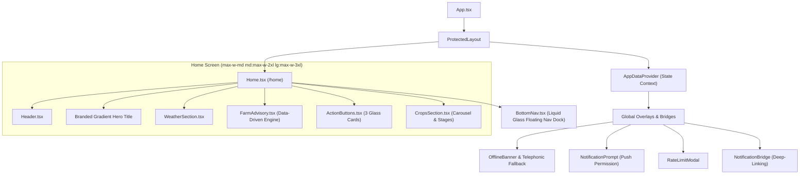

# AgriAssist — Premium Liquid Glass Home UI Documentation

Welcome to the comprehensive technical and functional documentation for the **Home Page UI** of **AgriAssist**. This document details the layout, visual design system, individual UI components, interactive features, state management, and real-time data flows that power the home experience.

---

## 1. Executive Summary & UI Philosophy

The AgriAssist Home Page (`/home`) serves as the central command cockpit for the farmer. Designed with a **mobile-first**, highly responsive layout that scales gracefully from small smartphones to tablets and desktop PWA windows, it consolidates critical agronomic telemetry—localized weather, daily data-driven farm advisories, crop phenology tracking, quick actions, and proactive alerts—into a cohesive, glanceable dashboard.

### Core Design Principles
* **Mobile-First & Desktop-Responsive**: Centered ergonomic container (`max-w-md md:max-w-2xl lg:max-w-3xl mx-auto`), ensuring single-thumb accessibility on mobile smartphones and balanced card proportions on wider displays.
* **Apple-Inspired Dark Liquid Glass Design System**: High-contrast, dark-mode visual hierarchy utilizing translucent backdrop-blurred panels (`glass-panel-dark`, `glass-surface-deep`, `glass-nav-dock`, `glass-action-card`), glowing radial gradients, and vivid lime green accents (`#A1E533` / Tailwind lime-400 palette) against a fixed background farm wallpaper.
* **Multilingual Accessibility**: Native internationalization (`i18next`) supporting English, Hindi (`हिन्दी`), and Tamil (`தமிழ்`) with instantaneous on-the-fly language switching across all headings, cards, and advisories.
* **Low-Latency Hydration with Graceful Fallbacks**: Asynchronous data pre-fetching via `AppDataContext` with shimmer skeleton loaders (`glass-skeleton`), empty-state placeholders, and automated offline resilience with telephonic fallback.

---

## 2. Visual Architecture & Layout Tree

The Home Page is rendered at `src/pages/Home.tsx` and protected by `ProtectedLayout` in `src/App.tsx`.



---

## 3. Detailed Component Breakdown

### 3.1. Top Header (`Header.tsx`)
*File Location: `frontend/src/components/Header.tsx`*

The header provides contextual identity, date tracking, language toggling, alert counters, and profile navigation in a compact, touch-optimized glass bar.

```
+-------------------------------------------------------------+
| Hello, Ramesh             [ Globe  English v ] [Bell (2)] [Avatar] |
| Thursday, 16 Oct, 2026                                      |
+-------------------------------------------------------------+
```

#### Key Capabilities & Features:
1. **Personalized Farmer Greeting**:
   - Checks `useAuth().user?.name` first for immediate rendering without waiting for network calls.
   - Concurrently synchronizes with the backend profile API (`userService.getProfile`).
   - Extracts the farmer's first name: `"Hello, {firstName}"`.
   - Defaults gracefully to `"Hello, Farmer"` while loading or if no name is registered.
2. **Localized Dynamic Date**:
   - Formatted using `Intl.DateTimeFormat` respecting active `i18n.language` (`en`, `hi`, `ta`).
3. **Compact Glass Pill Language Selector**:
   - Pill container with `<Globe size={13} />` icon and `<ChevronDown size={11} />`.
   - Instant language switching across:
     - `en` — English
     - `hi` — हिन्दी (Hindi)
     - `ta` — தமிழ் (Tamil)
   - Synchronized across the entire application via `i18next`.
4. **Interactive Notification Bell & Badge**:
   - Polls `/api/notifications/count` every **60 seconds** via `notificationService.getNotificationCount`.
   - Displays a dynamic badge showing unread notifications. If count exceeds 9, it renders `"9+"`.
   - Clicking routes directly to the `/notifications` center.
5. **Farmer Profile Avatar**:
   - Circular border avatar with lime green active indicator ring (`ring-2 ring-lime-400/40 hover:ring-lime-400`).
   - Clicking routes directly to the `/profile` page.

---

### 3.2. Branded Hero Headline
*File Location: `frontend/src/pages/Home.tsx`*

Prominently positioned below the header, this localized section displays an inspiring brand mission statement styled with a dual-gradient clip:
* **Copy**: *"Farming Made Simple, Smarter, and Sustainable"*
* **Gradient Highlights**:
  - *"Simple, Smarter"*: `linear-gradient(135deg, #A1E533 0%, #D6F6CF 60%, #FFFFFF 100%)`
  - *"Sustainable"*: `linear-gradient(135deg, #FFFFFF 0%, #D6F6CF 40%, #A1E533 100%)`
* **Typography**: Crisp 24px–30px font (`text-2xl sm:text-3xl font-semibold`) with relaxed leading.

---

### 3.3. Premium Weather Card (`WeatherSection.tsx`)
*File Location: `frontend/src/components/WeatherSection.tsx`*

The weather card delivers real-time meteorological intelligence for the farmer's precise coordinates, backed by the Open-Meteo API and synced with the farmer's registered land data (`landService.getMyLand`).

```
+-------------------------------------------------------------+
|  [Pin] Coimbatore, Tamil Nadu         [Open-Meteo] [Forecast >] |
|                                         +-----------------+ |
|  42° C                                  |  3D Weather     | |
|  16 Oct 2026 • Updated 12:45 pm         |  Illustration   | |
|                                         +-----------------+ |
|  [Sun] Sunny                                                |
|  ---------------------------------------------------------  |
|  Suggestion: Good conditions for farm activities.           |
+-------------------------------------------------------------+
| [Droplet] Rain (1h): 0 mm | [Wind] 12 km/h | [Humidity] 54% |
+-------------------------------------------------------------+
```

#### Detailed Features:
1. **Registered Farm Geolocation Pill**:
   - Displays the farmer's registered `{district}, {state}` (e.g., `"Coimbatore, Tamil Nadu"`).
   - If land data is loading, shows an informative state: *"Fetching location..."*.
   - If no farm location is registered, shows an honest prompt linking to `/profile`.
2. **Current Temperature & Timestamp**:
   - Large 52px typography (`text-5xl font-light text-white`) with localized Celsius symbol (`°C`).
   - Displays active date and updated time.
3. **Dynamic Weather Condition Chip**:
   - Maps Open-Meteo WMO weather codes to user-friendly conditions:
     - Clear / Sunny (WMO 0)
     - Partly Cloudy (WMO 1, 2)
     - Cloudy / Overcast / Fog (WMO 3, 45, 48)
     - Rain / Drizzle / Showers (WMO 51–65, 80–82)
     - Snow / Freezing Drizzle (WMO 71–77, 85–86)
     - Thunderstorm (WMO 95–99)
   - Dynamic badges adapt colors and Lucide icons automatically (`Sun`, `CloudSun`, `Cloud`, `CloudRain`, `CloudLightning`, `Snowflake`).
4. **3D Weather Illustrations**:
   - Dynamically loads high-fidelity 3D rendered assets from `frontend/src/assets/weather/`:
     - `sunny.png`, `sunny_and_cloudy.png`, `cloudy.png`, `rain.png`, `thunderstrom.png`, `snow.png`.
5. **Contextual Agro-Advisory Suggestion**:
   - Real-time rule evaluation based on precipitation:
     - **Precipitation > 0 mm**: *"High moisture detected. Delay spraying chemicals."*
     - **Precipitation = 0 mm**: *"Good conditions for farm activities."*
6. **Tri-Metric Surface Grid (`glass-surface-deep`)**:
   - **Precipitation**: Measures rainfall accumulation for the stated period (`Current Hour: X mm`).
   - **Wind Speed**: Measures air velocity in `km/h`.
   - **Relative Humidity**: Open-Meteo relative humidity percentage (`%`).
7. **Forecast Deep-Link**:
   - Unobtrusive button (`t('weather.viewForecast')`) navigating directly to `/forecast`.
8. **Shimmer Skeleton Loading**:
   - Shimmer skeleton displaying placeholders for the main card and metric surfaces while data is loading.

---

### 3.4. Intelligent "Today's Farm Advisory" (`FarmAdvisory.tsx`)
*File Location: `frontend/src/components/FarmAdvisory.tsx`*

A data-driven agricultural intelligence engine replacing static mock recommendations with deterministic, testable agronomic rules.

```
+-------------------------------------------------------------+
| [Sprout] Today's Farm Advisory                     [ 1/3 done ] |
+-------------------------------------------------------------+
| [O] Check irrigation needs                           [ Low ]  |
|     Review soil moisture before watering.                   |
|     Why? Avoid excess watering and conserve water.           |
|     [Tag] Dry weather (weather data)                         |
+-------------------------------------------------------------+
| [V] Inspect crop leaves                            [ Medium ]|
|     Inspect Paddy for visible pest or foliar signs.         |
|     Why? Early detection helps prevent crop loss.           |
|     [Tag] Active crop: Paddy                                 |
+-------------------------------------------------------------+
| View Full Forecast >                                        |
+-------------------------------------------------------------+
```

#### Deterministic Rule Engine:
1. **Irrigation & Moisture Rule**:
   - **Rain detected (`precipitation > 0`)**: Recommends *Delay chemical spraying* (Priority: High). Why: Rain washes away chemicals, wasting resources. Evidence: Precipitation recorded.
   - **Extreme heat (`temperature >= 35°C`)**: Recommends *Protect crops from heat* (Priority: High). Why: Irrigate early morning or late evening to reduce heat stress. Evidence: Air temperature recorded.
   - **Favorable / dry weather**: Recommends *Check irrigation needs* (Priority: Low). Why: Avoid excess watering and conserve water resources.
2. **Crop Surveillance Rule**:
   - Evaluates active crops registered by the farmer (`activeCrops[0]`).
   - Generates targeted leaf inspection recommendation for the primary crop: e.g. *Inspect Paddy for visible pest or foliar signs*.
3. **Growth Stage / Nutrition Rule**:
   - Evaluates phenological progress: if any active crop has passed seedling stage (>15% growth days), generates *Plan fertilizer application*. Why: Timely fertilization optimizes yield and reduces waste.
4. **Interactive Completion Toggle**:
   - Farmers can mark tasks as completed (`[X] done`), persisted locally by calendar date (`localStorage`).
   - Header shows live progress counter (`X/Y done`).
5. **View Full Forecast Affordance**:
   - Direct link navigating to `/forecast` for satellite NDVI, waterlogging risk, and heat stress diagnostics.

---

### 3.5. Quick Actions — Three Premium Glass Cards (`ActionButtons.tsx`)
*File Location: `frontend/src/components/ActionButtons.tsx`*

Three distinctive glass action cards with tailored ambient lighting, hover elevation, and direct feature connectivity:

```
+--------------------+ +--------------------+ +--------------------+
| [Bot]         [^]  | | [Camera]      [^]  | | [Landmark]    [^]  |
|                    | |                    | |                    |
| AI Assistance      | | Scan Crop          | | Schemes            |
| Ask farming quest. | | Detect crop dis.   | | Explore gov. schem.|
+--------------------+ +--------------------+ +--------------------+
```

1. **AI Assistance**:
   - Icon: `Bot` with lime-green accent (`text-lime-400 bg-lime-400/10 border-lime-400/20`).
   - Title: `AI Assistance` (`t('actions.aiAssistance')`).
   - Subtitle: `Ask farming questions` (`t('actions.askFarmingQuestions')`).
   - Ambient Glow: `glow-green` (`rgba(161, 229, 51, 0.12)`).
   - Navigation: Routes to `/chat` with state `{ starterPrompt: 'Help me with my crop today.' }`.
2. **Scan Crop**:
   - Icon: `Camera` with cyan/mint accent (`text-cyan-400 bg-cyan-400/10 border-cyan-400/20`).
   - Title: `Scan Crop` (`t('actions.scanCrop')`).
   - Subtitle: `Detect crop diseases` (`t('actions.detectDiseases')`).
   - Ambient Glow: `glow-cyan` (`rgba(34, 211, 238, 0.10)`).
   - Navigation: Routes to `/scan-crop` for computer vision crop disease detection.
3. **Schemes**:
   - Icon: `Landmark` with subtle violet accent (`text-violet-400 bg-violet-400/10 border-violet-400/20`).
   - Title: `Schemes` (`t('actions.schemes')`).
   - Subtitle: `Explore government schemes` (`t('actions.exploreSchemes')`).
   - Ambient Glow: `glow-violet` (`rgba(167, 139, 250, 0.10)`).
   - Navigation: Routes to `/farm-details#schemes`, triggering an automatic smooth scroll to the Government Schemes recommendation engine.

---

### 3.6. Your Crops Phenology Section (`CropsSection.tsx`)
*File Location: `frontend/src/components/CropsSection.tsx`*

A Liquid Glass carousel monitoring all active crops sown across the farmer's registered fields.

```
+-------------------------------------------------------------+
| Your Crops                                      View all >  |
| +-------------------------+ +-------------------------+     |
| | [Paddy Img] Paddy       | | [Cotton Img] Cotton     | ... |
| | [Pin] North Plot        | | [Pin] East Field        |     |
| | [o] Vegetative Stage    | | [o] Flowering Stage     |     |
| | [Cal] 42 days           | | [Cal] 65 days           |     |
| +-------------------------+ +-------------------------+     |
+-------------------------------------------------------------+
```

#### Detailed Capabilities:
1. **Dynamic Field Name Matching**:
   - Cross-references `assignment.fieldId` against `fields` list from `AppDataContext` to display the actual plot name (e.g., *"North Plot"*).
2. **Horizontal Smooth Carousel**:
   - Scrollable container (`overflow-x-auto no-scrollbar`) with card widths of `240px` and hover translation (`hover:-translate-y-1`).
3. **Phenological Stage Calculation**:
   - Calculates active stage (`Seedling Stage`, `Vegetative Stage`, `Flowering Stage`, `Fruiting Stage`, `Ready to Harvest`) using sowing dates and cycle lengths.
4. **Days Elapsed Counter**:
   - Computes days since sowing (`t('crops.daysOld', { count: daysElapsed })`).
5. **Card Navigation**:
   - Clicking any crop card navigates directly to `/farm-details`.
6. **Header "View All" Action**:
   - Navigates to `/farm-details`.
7. **Empty State**:
   - Clean glass card with `Sprout` icon and "Add Crops" button routing to `/profile`.

---

### 3.7. Floating Bottom Navigation Dock (`BottomNav.tsx`)
*File Location: `frontend/src/components/BottomNav.tsx`*

A floating Liquid Glass navigation dock anchored at the bottom of the viewport with device safe-area handling:

```
===============================================================
       [ (Home)       (Forecast)       (Chat)       (Farm) ]
===============================================================
```

| Tab Item | Route | Icon | Active State | Purpose |
| :--- | :--- | :--- | :--- | :--- |
| **Home** | `/home` | `<Home />` | **Active** (Filled icon, lime-green glow `shadow-[0_0_12px_rgba(161,229,51,0.25)]`, `text-lime-400 font-semibold`) | Returns to main dashboard |
| **Forecast** | `/forecast` | `<ShieldAlert />` | Inactive (`text-gray-400 hover:text-gray-200`) | Satellite NDVI analytics & disaster risks |
| **Chat** | `/chat` | `<MessageCircle />` | Inactive (`text-gray-400 hover:text-gray-200`) | AI agronomist with ElevenLabs voice mode |
| **Farm** | `/farm-details`| `<LayoutGrid />` | Inactive (`text-gray-400 hover:text-gray-200`) | Field geometry, soil/IoT metrics, and schemes |

- **Safe-Area Insets**: Incorporates `env(safe-area-inset-bottom, 0px)` so navigation dock never overlaps device home indicators.
- **Accessibility**: Includes `aria-current="page"`, `glass-focus-ring`, semantic `<nav aria-label="Main Navigation">`, and comfortable `44x44px` touch targets.

---

## 4. Protected Layout & Global Background Overlays

The Home page runs inside `ProtectedLayout` (`frontend/src/App.tsx`), which provides:
1. **`OfflineBanner`**: Active 5-second connectivity check with emergency automated outbound telephonic fallback via Twilio/ElevenLabs.
2. **`NotificationPrompt`**: PWA push notification onboarding modal with category toggles and 3-day cooldown persistence.
3. **`RateLimitModal`**: Quota guard presenting upgrade options upon encountering HTTP 429.
4. **`NotificationBridge`**: Notification click listener deep-linking to target alerts.

---

## 5. Styling, Theming & Liquid Glass Design Tokens

Defined in `frontend/src/index.css`:

```css
/* Liquid Glass Design System Utilities */
.glass-panel-dark {
  background: rgba(10, 18, 14, 0.58);
  backdrop-filter: blur(20px) saturate(145%);
  -webkit-backdrop-filter: blur(20px) saturate(145%);
  border: 1px solid rgba(255, 255, 255, 0.10);
}

.glass-surface-deep {
  background: rgba(6, 12, 9, 0.72);
  backdrop-filter: blur(16px) saturate(130%);
  -webkit-backdrop-filter: blur(16px) saturate(130%);
  border: 1px solid rgba(255, 255, 255, 0.06);
}

.glass-nav-dock {
  background: rgba(8, 14, 10, 0.82);
  backdrop-filter: blur(32px) saturate(160%);
  -webkit-backdrop-filter: blur(32px) saturate(160%);
  border: 1px solid rgba(255, 255, 255, 0.12);
  box-shadow:
    0 8px 32px rgba(0, 0, 0, 0.4),
    0 0 0 0.5px rgba(255, 255, 255, 0.06) inset,
    0 1px 0 0 rgba(255, 255, 255, 0.05) inset;
}

.glass-action-card {
  background: rgba(10, 18, 14, 0.55);
  backdrop-filter: blur(20px) saturate(140%);
  -webkit-backdrop-filter: blur(20px) saturate(140%);
  border: 1px solid rgba(255, 255, 255, 0.08);
  transition: transform 0.2s ease, box-shadow 0.2s ease, border-color 0.2s ease;
}

/* Ambient glow tokens */
.glow-green {
  box-shadow: 0 0 20px rgba(161, 229, 51, 0.12), 0 0 40px rgba(161, 229, 51, 0.06);
}

.glow-cyan {
  box-shadow: 0 0 20px rgba(34, 211, 238, 0.10), 0 0 40px rgba(34, 211, 238, 0.05);
}

.glow-violet {
  box-shadow: 0 0 20px rgba(167, 139, 250, 0.10), 0 0 40px rgba(167, 139, 250, 0.05);
}
```

---

## 6. Verification & Quality Gates

The redesigned codebase passes all quality benchmarks:
- **TypeScript**: `tsc -b` compiled cleanly with **0 errors**.
- **ESLint**: `eslint` verification on all updated pages and components completed with **0 errors and 0 warnings**.
- **Vite Production Bundler**: `vite build` generated all optimized production assets in `dist/`.
